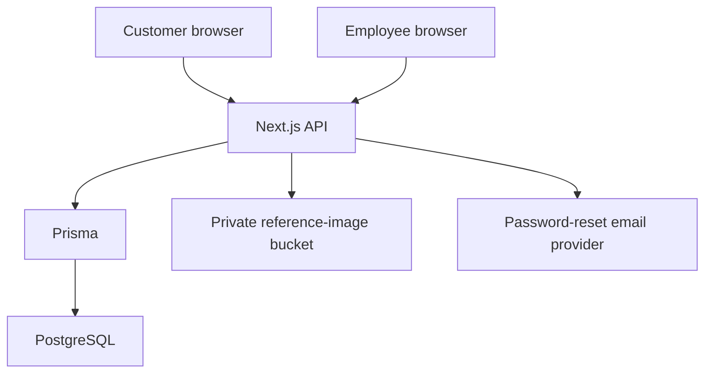

# ByteBites — database-connected version

This standalone Next.js application connects the tattoo studio UI to PostgreSQL through Prisma. It replaces browser-only business records with authenticated API calls. It preserves the existing 3D body canvas and the black/white/pink visual direction, and provides a new readable portal component for the connected workflows.

**Begin with [CONNECTING.md](CONNECTING.md)** for the Windows/VS Code setup, PostgreSQL settings, accounts, deployment and optional storage/email configuration.

## Implemented

- Customer registration and separate customer/employee sign-in using individual email/password accounts.
- scrypt password hashing (N=131072), hashed random database session tokens, HttpOnly cookies, expiry, sign-out, password reset and session revocation.
- Server checks for every API operation, ownership restrictions, database-backed login/write rate limits and Origin checks.
- Original-ID review at the studio, encrypted identity metadata, explicit adult policy, corrections and staff approval. No identity image or ID number collection.
- Versioned intake/consent with application encryption and server timestamps.
- Appointment requests with 3D placement, staff confirmations/declines/quotes, cancellation and conflict checks under an artist-specific PostgreSQL advisory transaction lock.
- Encrypted appointment message threads, shared across computers through the database.
- Optional private S3-compatible reference image uploads with type sniffing, a 3 MB limit, application encryption and authorized downloads. JPEG/PNG/WEBP only.
- Completed service records with encrypted visit snapshots, two-year minimum review dates, holds and a manual retention report. No record deletion job is enabled.
- Migration SQL, sample artists, staff bootstrap command, connection checks, tests and local PostgreSQL Docker Compose.

## Files to read first

| File | Responsibility |
| --- | --- |
| `prisma/schema.prisma` | Real relational schema and foreign keys |
| `prisma/migrations/20261112000000_initial/migration.sql` | Initial database migration |
| `lib/db.ts` | Prisma/PostgreSQL connection |
| `prisma.config.ts` | Prisma CLI migration connection using `DIRECT_URL` |
| `app/api/[...path]/route.ts` | Authenticated API routes |
| `lib/security.ts` | Sessions, ownership helpers, limits and Origin checks |
| `lib/crypto.ts` | Password hashing and authenticated record encryption |
| `lib/operations.ts` | ID gate, shared records and service completion |
| `lib/storage.ts` | Optional encrypted private reference images |
| `components/ConnectedPortal.tsx` | Customer and employee screens connected to API |
| `components/BodyCanvas3D.tsx` | Original authored 3D mannequin |
| `.env.example` | All connection variable names with placeholders |

## Connection map

No database password, encryption key, session token or private storage credential is shipped to browser JavaScript. Passwords are hashed. ID metadata, health notes, consent signature details, messages and service snapshots are encrypted with AES-256-GCM, bound to their client or record context. The PostgreSQL/storage provider must also enable TLS, disk encryption, backups and access controls.

## Validation

`npm test` covers password verification, unique salts, authenticated encryption, context isolation and the adult birthday cutoff. `npm run test:flows` starts a temporary PostgreSQL-compatible PGlite engine and the actual Next.js API in one process tree. It tests customer/staff sessions, shared records, cross-customer denial, ID approval, intake, appointment confirmation/conflicts, messages, service retention/holds, reset replay/revocation and logout. PGlite is a test dependency. The production adapter is `@prisma/adapter-pg` with `pg` against PostgreSQL. Repeat concurrency and backup/restore tests against your actual hosted PostgreSQL before launch.

The test database and temporary credentials are excluded from the deliverable. The production build, TypeScript checks, migration CLI, seed and connection checker were verified. The final runtime dependency audit reported no known vulnerabilities. Browser visual testing, actual S3 uploads and actual Resend email delivery were not verified in this environment.

## Operational boundaries before real clients

This is implemented code for a pilot deployment, not a certification of legal compliance. The earlier Sites demo remains a separate deployment until this application is deployed with your own services. No hosted database, bucket or email account has been provisioned or linked by this task.

The sample waiver, artist profiles and recordkeeping workflow need studio approval. The online policy accepts adults 18+. It excludes Tennessee's limited minor cover-up pathway. Completed visit records snapshot the actual service date, identity, signature, design, body location, artist and attestations. Retention review is calculated from service, never from initial registration. Legal holds persist. Electronic signature/record acceptance, original-ID inspection procedure, health department access on the premises, aftercare wording, and backup retention must be confirmed with the studio and its inspector.

Additional operational work includes email ownership verification if required by the studio, MFA for staff, restore drills, monitoring/alerting, incident response, dependency maintenance, pagination for studios with more than 200 recent records, hardened image re-encoding/scanning, and key rotation procedures. Password reset is fully wired but requires a verified email sender. Reference storage is fully wired but requires a private bucket. These features report an explicit configuration error when their services are absent.

There is no automatic import of plaintext browser demo data or the older Python SQLite backend. Import only reviewed, consented records through a separately audited migration. This application uses a new empty PostgreSQL database.

## Sources checked during implementation

- Next.js authentication — https://nextjs.org/docs/app/guides/authentication
- Prisma v7 PostgreSQL — https://www.prisma.io/docs/orm/v7/overview/databases/postgresql
- Prisma migration deployment — https://www.prisma.io/docs/orm/v7/prisma-client/deployment/deploy-database-changes-with-prisma-migrate
- Vercel storage integrations — https://vercel.com/docs/marketplace-storage
- Vercel environment settings — https://vercel.com/docs/environment-variables
- AWS S3 public access blocks — https://docs.aws.amazon.com/AmazonS3/latest/userguide/access-control-block-public-access.html
- Tennessee Department of Health linked statute copy (marked 2014) — https://www.tn.gov/content/dam/tn/health/pdf/Tattoo-law.pdf
- Published Tennessee tattoo rules — https://publications.tnsosfiles.com/rules/1200/1200-23/1200-23-03.20240922.pdf
- Current secondary cross-check of T.C.A. §62-38-207 — https://law.justia.com/codes/tennessee/title-62/chapter-38/part-2/section-62-38-207/
